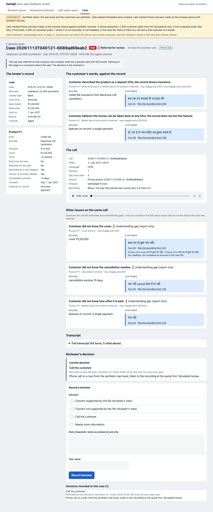

# Samajh

**One-page pitch:** [PITCH.md](PITCH.md)

Samajh is a Hindi and Hinglish voice callback for lenders and their compliance reviewers: it asks a borrower, in their own words, what they bought with their loan; a language model turns the answer into fixed fields, every quote is checked against what was said, and plain code compares the fields with the lender's record, so a human reviewer gets quotes and audio offsets to look at, never a verdict.

Status in one line: it runs end to end on synthetic data. Customer voices in the prepared calls are Timbre audio; the only human audio is two practice calls by one builder (not scored). The call's latest independent check (typed text, not speech) found it ready for consenting testers playing customers, with the classifier on and degraded sessions voided, and not ready for anyone else (details under "Status" below).



*A case page for one synthetic phone call (a loan drawn from the synthetic loan book, prepared Timbre customer audio), rendered on 2026-11-13 at commit 2568759: a call referred on what the customer said. It is attempt 1 on its loan, so the half-yearly report counts it (on these pages it was ingested before the simulated calls; `references/pilots/p3b-artifacts/RENDERED.md`). A flag is evidence for a human to review, not a finding. The reviewer pages may differ from this picture after later changes.*

## Three numbers (amounts that skip a place-value group)

All three are on synthetic or public speech, not on real callers, and all use the wording the independent verification allows (`references/reviews/iter2/verify-P6.md`, "Wording for a public submission").

1. **40 of 68, against 0 of 68.** On a held-out synthetic set built to stress amounts that skip a place-value group (TTS audio, simulated 8 kHz phone audio), Prisma v3.0 `transcribe` wrote a different amount for 40 of 68 such amounts (59%, 95% CI 47-70) and for 0 of 68 matched controls. Its `verbatim` output of the same audio had the right number words in all 40, and v2.5 `transcribe` wrote none wrong. 26 of the 40 are wrong under any reading ("one lakh three hundred" written as 1,300; "five crore twenty-six thousand" as 5,26,000); the other 14 are "X lakh Y" phrases that colloquial Hindi may mean differently. The 68 are 24% of the set by design, so this is not a rate of how often amounts go wrong.
2. **224 of 280.** Accepting an amount only when Prisma v3.0 and v2.5 `transcribe` agree accepted 224 of 280 synthetic clips with no wrong amount accepted. The rule was written into the experiment plan before any audio was voiced (`verify-P6.md`, finding 3); a cheaper variant was chosen on these same sets and is not claimed.
3. **113 of 124.** The same rule accepted 113 of 124 public Hindi read or extempore recordings (IndicVoices and Kathbath) with no wrong amount accepted. 107 of the 124 are from the datasets' train splits, which Gnani may have trained on, so this may be optimistic; only 4 of the recordings skip a group (v3.0 was wrong on 1: too few for a rate).

Sources: counts in `eval/amounts_v2/tables-tts.md` (phone condition, from line 207) and `eval/amounts_v2/tables-realvoice.md` (phone condition, from line 128), recomputed independently in `verify-P6.md`.

## Gnani models and endpoints used

Base URL `https://api.vachana.ai`, one key in the `X-API-Key-ID` header, held by a backend proxy.

- **Prisma STT v3.0 (`prisma-v3.0`) and v2.5 (`prisma-v2.5`)** through `POST /stt/v3` (REST, clips of 30 s or less): `format=transcribe`, language set per call. v3.0 reads every customer turn; v2.5 gives a second reading where the call expects a figure (for example the premium).
- **Prisma Batch** (`prisma-v3.0`, `/stt/v3/batch/jobs`, two speakers): the whole call after it ends, for segment times that give each quote its audio offset.
- **Timbre TTS v3.0** (`timbre-v3.0`, `POST /api/v1/tts/inference`, 8 kHz, voice Shivani): the bot's lines, and the synthetic customers used in testing.
- Not used: streaming, voice cloning, Agent Builder. Extraction after the call uses `openai/gpt-6-luna` through OpenRouter, and the dialogue's turn classifier uses `mistralai/mistral-small-3.2-24b-instruct` (`DESIGN.md` section 7).

## Why two Prisma models

The difference above is between the two models on one kind of amount: v3.0 `transcribe` wrote a different number for amounts that skip a place-value group, while its `verbatim` output of the same audio had the right words and v2.5 wrote none wrong. Which stage causes it is not established. So Samajh asks both models when the customer says a figure, accepts the amount only when they agree, and otherwise asks again.

What the agreement rule adds depends on the data. **On the held-out synthetic set it adds nothing measured:** v2.5 `transcribe` alone wrote no wrong amount (0 of 280; 268 right, 12 refused), while agreement accepted 224, so there it costs 44 more re-asks (on the 68 skipped-group amounts, 22 accepted against 66 for v2.5 alone). **The case for it rests on the 124 public recordings** (`tables-realvoice.md`, phone condition, lines 197-201): v2.5 alone accepted 119 and wrote a wrong amount on 4 (for example 500 as 100); v3.0 alone accepted 123 and was wrong on 3; agreement accepted 113 with 0 wrong, because the two readings differed on each of the 6 clips where either was wrong. That is 4 and 3 wrong against 0 on one small set, mostly from train splits and with only 6 clips at stake, so it is a reason to keep the check, not a measured gain. On a figure turn the dialogue is given v2.5's reading first and reads back v2.5's figure when the two differ; v3.0 is the reading for every other turn (it refused fewer of these recordings: 1 of 124, against 5 for v2.5).

## What one completed call costs (estimate)

One whole hero call (Hindi, the P1 run on 2026-11-10, session `20261110T103108-9f2e34f8dfdf`: 15 customer turns, a 157.47 s recording, tier `refer`). Gnani credits come from the client's own rates, 0.010 per audio second and 0.002 per TTS character (`samajh/clients/defaults.toml`); no API reports cost, so these are estimates, each possibly 20% off or more, and the dashboard has not been read. The turn and read-back figures are the per-request estimates in the call's session log (`.samajh/sessions/20261110T103108-9f2e34f8dfdf/session.json`); the Batch figure is the `batch.billed` row for 157.47 s in `.samajh/ledger.jsonl`, the file that `uv run python -m samajh.clients.gnani ledger` totals (a local read).

| Part | Quantity | Arithmetic | Credits |
|---|---|---|---|
| Turn STT, v3.0 (15 readings) and v2.5 (2 readings) | 26.80 s + 2.64 s = 29.44 s | 29.44 x 0.010 | 0.294 |
| Prisma Batch, whole recording (assumed to bill like STT) | 157.47 s | 157.47 x 0.010 | 1.575 |
| Timbre, one read-back made on the call | 54 characters | 54 x 0.002 | 0.108 |
| **Total** | | | **about 1.98** |

The 24 fixed bot lines in that call came from the cache (1,612 characters, 3.22 credits if voiced fresh); they are made once for all calls (70 fixed lines per language; the round 3 re-voice of 92 new clips cost about 12.6 credits by the same estimate, `references/pilots/P1c-report.md` section 3, and the lines are voiced again after the wording review). The LLM that reads the transcript after the call cost $0.00171 per transcript on the frozen set (144 transcripts, $0.24589; `DESIGN.md` section 7), and the hero call's own 21 extraction requests cost $0.00134 in the ledger. The turn classifier that runs during the call is not included: its 15 requests across the three calls in that time window cost under $0.0005 together. Caveats: Timbre voices speak short answers, so a person talking longer costs more STT and Batch; the call ran on the dialogue as it was before P2's fix rounds, and the bot's lines will change after the wording review; and one call is not an average.

## Run it

Needs the setup below (Python 3.11, `uv`, `ffmpeg`, keys in `.env`). The phone spends Gnani credits and needs `GNANI_API_KEY`:

```
uv run python -m samajh.server --port 8085
```

Open `http://127.0.0.1:8085/` in Chrome and place a call. To see the dialogue as text, with no audio, no key and no credits:

```
uv run python -m samajh.dialogue play --record tests/dialogue/fixtures/record_gold_loan.json --lang hi
```

---

## About this project

Samajh is a post-sale understanding callback for Indian lenders: an open-question comprehension check. The customer explains in their own words, in their own language, what they bought with their loan; a language model turns the answers into fixed fields, and plain code compares them against the bank's records. Where an answer conflicts with the record, the case becomes evidence a human can review; gaps in understanding are counted in the half-yearly report.

It is built for Gnani AI's Great Indian AI Internship Challenge on Prisma STT and Timbre TTS, and targets the post-sale feedback duty in RBI para 85Y (commercial banks) and 101Y (NBFCs), in force from 1 January 2027: a mechanism to seek feedback within 30 days of a sale, to check that customers understood the product's features and risks, and a half-yearly report on the findings. 85Y sets no channel and does not require random sampling, call-backs or an independent unit; it names call-backs and surveys as examples. All data is synthetic. The product languages are Hindi and Hinglish; Tamil and Kannada stay in the code as experimental.

**Team:** Pranav Pandian and Sambhav Jain.

## Status (2026-11-13, at commit 2568759)

Iteration 1 built the parts and was reviewed by two verifiers and a judge: continue with changes, because the parts had never been joined into one call. Iteration 2 joined them. Each package was checked by an independent verifier that wrote none of the code, on inputs the builder never saw; the reports are in `references/reviews/iter2/`. Iteration 3 (commit 2568759: the right-party setting, fix rounds for the call and the decision chain, a P5 runner) was checked by two more independent verifiers on typed text (`references/reviews/iter3/`); work by the ops builder and a P5 test fix are in progress now and not verified. In short:

| Part | State |
|---|---|
| The call on the browser phone, to a case file (P1) | Built and independently verified (sound; `verify-P1b-r2.md`). A whole call (disclosure, questions, read-backs, close) runs through the real HTTP API and ends in a case file with a tier, a short summary and every quote with its audio offset. A call can be placed for a loan drawn from the loan book and its case enters the reviewer queue (`ops ingest`). Customer voices in the prepared calls are Timbre audio; one builder made two practice calls by microphone on 2026-11-10 (not scored). No person has made a call on a loan from the book, and no listening pass on the bot's voice has been done. The later server changes for the dialogue's last rounds (`P1c-report.md`) are builder evidence only. The page has a picker for the right-party setting and shows a mocked written notice ("SMS, mocked: not sent"); the verifier read the page as code and did not open it in a browser; the case file reads the dialogue's own turn texts (v2.5 on figure turns) |
| The call itself, `samajh/dialogue` (P2) | Built; independent verification on typed text, not speech, through iteration 3. Latest verdict (`references/reviews/iter3/verify-call.md`): **ready for consenting testers playing customers, with the classifier on and degraded sessions voided; not ready for anyone else.** The right-party check is a lender setting (P8, `samajh/identity/`): the default is none, which asks "are you <first name> yourself?" and treats a person who says yes twice as the borrower (5 of 5 such false claimants passed); the year of birth is the lender's opt-in, one attempt by default or two. This is a right-party check, not identity verification. In the verifier's wording: "On 151 verifier-written Hindi and Hinglish typed inputs, with no second check, 16 of 16 genuine borrowers passed (classifier live), and 16 of 16 third parties at the opening did not pass in each arm, with nothing named before the pass." "26 of 26 opening refusals ended as asked with the classifier live (25 of 26 failing)." "A bare yes at the who-check ended the call in every case that reached it (8 of 8 live, 10 of 10 failing)." "On 78 new verifier-written typed inputs, every takeover sign after the pass (17 of 17, each arm) got the who-check or an end with no lender, loan or figure spoken after it." "With the classifier failing, 1 of 4 natural self-claims at the who-check resumed." "With two attempts, 5 of 5 pairs of wrong years ended the call." "The case file withholds the reply to the year question and the Batch segments that overlap it in time; the on-disk dialogue state and the audio still hold it." Known limits: the turn classifier must be on and a session with a degraded turn is void; what is left costs genuine borrowers (a natural self-claim that mentions a relative at the who-check ends the call; "mera no. hata do bhai" ends it as `wrong_party`); with the year of birth on, an explicit claimant still hears the lender named before the year; a third party who knows the year passes the year check (3 of 3); no fluent reviewer has read the lines (72 per language) and nothing has been tested on speech |
| The decision chain (P3a) | Built and independently verified on typed text: `verify-P3a-r3.md` (sound with conditions) and, for iteration 3's fix round (one-clause withdrawals, bounds, romanised amounts, pinned prompts), `references/reviews/iter3/verify-chain.md` ("sound with conditions, with one regression to fix before use"; after its recheck "holds with conditions"). The last fix round answered the recheck's four items and is **not re-verified**. Four tiers: `refer`, `incomplete`, `understanding_gap`, `clear`. A referral shows whether it rests on what the customer said or on the lender's record alone (P3c, `P3a-report.md`; its fixes were confirmed by the coordinating worker only, not by a second independent check). Verifier's wording: "On 23 typed withdrawals that hold a marker word (one-clause, punctuated or carried from recall), none ended `clear`." "On 10 typed corrections away from the record, the taken-back value was never the stated answer." Known limits: before the last round, 2 of 13 one-clause withdrawals with a "who knows / forgot" tail ended `clear` (both ended in "या फिर कुछ और") and 9 of 13 informed one-clause replies were falsely `incomplete`; one-clause corrections are `incomplete`; a withdrawal is a rule the code applies, not a guarantee |
| Loan book, reviewer queue, half-yearly report (P3b) | Built and independently verified (sound with conditions in five rounds, latest `verify-P3b-r5.md`; round 2 recounted every report number from the raw files and matched, `verify-P3b-r2.md`, before the P3c split was added). Over a synthetic 200-loan book with simulated customers, so no share it shows says anything about a real lender. The rendered pages in `references/pilots/p3b-artifacts/` were re-rendered on 2026-11-13 and may differ from the code after later changes |
| The Gnani amounts finding (P6) | Built and independently verified: every number reproduced and the freeze order confirmed. Result at the top and below |
| Human calls (P4), evaluation of Samajh on customers the builders did not script (P5) | Not run. P4: 24 brief cards are written; the two practice calls of 2026-11-10 are the only calls by a person, and neither counts. P5: the customer set (60 customers) is prepared and frozen (`data/p5/`); the runner is committed (2568759) with a 6-call text dry run that is not a result, it has not been independently verified, and its player test fails (`tests/p5/test_p5_player.py`, a fix in progress) |

What is measured so far, each with what limits it:
- **Prisma v3.0 and amounts that skip a place-value group (held-out, TTS audio).** On a held-out set of 280 synthetic Hindi and Hinglish sentences, on simulated 8 kHz phone audio, v3.0 `transcribe` wrote a different amount for 40 of 68 skipped-group amounts (59%, 95% CI 47-70) and for 0 of 68 matched controls. Its `verbatim` output of the same audio had the right number words in all 40, and v2.5 `transcribe` wrote none wrong. 14 of the 40 are "X lakh Y" phrases that colloquial Hindi may mean differently; 26 are wrong under any reading. Accepting an amount only when v3.0 and v2.5 agree accepted 224 of 280 synthetic clips and 113 of 124 public Hindi recordings, with no wrong amount accepted; the recordings are mostly from training splits of public datasets and only 4 skip a group, so they are a separate, possibly optimistic result. Details and the full list of what is not claimed: `eval/amounts_v2/REPORT.md`, `eval/amounts_v2/`, `references/reviews/iter2/verify-P6.md`.
- **The decision chain on scripted text (not speech).** The frozen scenario set (144 calls written by the team, 36 base cases; Hindi and Hinglish are 72 calls) was rerun after P3a's changes (one live pass, then cache-only reruns after each fix round; after iteration 3's round every headline and triage number is identical to before): of 38 Hindi and Hinglish calls with a customer problem, 2 ended `clear` or `understanding_gap` (1 of 19 base cases: a wrong cancellation window, which is `understanding_gap` by design); of 18 informed customers on a compliant record, 0 were referred; of 16 informed customers with a fault on the lender's record, 8 were referred. Referrals are given as two counts side by side: on this frozen text set 2 of 16 informed calls with a record fault (1 base case) were referred on the record alone and all 30 problem referrals rest on what the customer said (a record-only referral does not mean the customer understood, and no record-only count here says anything about a real lender). Gold agrees with the rule engine on 144 of 144 partly because of a coordinator decision on 8 scenarios. Report: `eval/text_path/runs/frozen__openai-gpt-6-luna.md`. The teach-back against yes/no comparison (E1) is retired as a headline because it is true by construction.
- **Gnani API behaviour** measured live, including that the one-request limit is per account and not per key (`references/pilots/api-probe-iter1.md`).

Not verified: anything on human speech (the only human audio is two unscored practice calls by one builder); anything in Tamil or Kannada (no fluent reviewer); the bot's wording (no fluent human has read a line, and no listening pass has been done); the end-of-speech thresholds (not set on human audio). The iteration 3 verifier ran the whole suite once (see "Run the tests").

## Set up

Needs Python 3.11, [uv](https://docs.astral.sh/uv/) and `ffmpeg` on the path.

```
uv sync
cp .env.example .env     # then fill in GNANI_API_KEY and OPENROUTER_API_KEY
```

`.env` is gitignored. Never commit or print a key.

## Run the phone

Needs the setup above and `GNANI_API_KEY` in `.env`. Every call spends Gnani credits.

```
uv run python -m samajh.server --port 8085
```

Then open `http://127.0.0.1:8085/` in Chrome, pick a record and a language (Hindi or Hinglish) and place the call. The record picker holds four packaged demo records (amount-check, hero, informed, third-party) and, when a batch has been drawn (`uv run python -m samajh.ops demo`), a group "Synthetic loan book (drawn loans)" whose loans can be called; that call's case enters the reviewer queue through `ops ingest`. `SAMAJH_RECORDS_DIR` names one more directory of records. The page also has a picker for the lender's right-party setting (None, the default, or Year of birth with one or two attempts), with its description under it, and shows the mocked written notice ("SMS, mocked: not sent"). The server runs the Samajh dialogue by default (the three-question `stub` dialogue stays for tests: `replay --dialogue stub`). It binds 127.0.0.1 only; `--allow-host NAME` admits another host name. Optionally pre-make the bot's fixed lines so a call finds them in the cache: `uv run python -m samajh.server.prompts build --lang hi --lang hi-en`. To run a whole call without a microphone, with the server running:

```
uv run python -m samajh.server.replay tests/fixtures/server/calls/hero --url http://127.0.0.1:8085 --out OUT
```

The prepared calls in `tests/fixtures/server/calls/` were re-prepared for dialogue round 3 and replayed to a case file in P1c (`references/pilots/P1c-report.md`, section 4; builder evidence), then re-prepared in iteration 3: hero, informed and third-party run under the default setting (no second check) and amount-check under the year of birth with one attempt (`references/pilots/P2-report.md` section 8). If the bot's lines change, replay stops with `script_drift` until the calls are re-voiced (`references/pilots/P1-report.md`, section 4).

Gnani allows one active request per account. Do not run an evaluation while a call is live: a live turn waits 5 s for the lock, then fails with `gnani_busy`. Session logs, recordings and case files are written under `.samajh/sessions/`.

## Run the review pages

The reviewer queue, case pages, attempt log and half-yearly report read a batch from `.samajh/ops`. Build the simulated batch (scripted customers and extraction, no model, no network), then start the phone server and open `http://127.0.0.1:8085/review/`:

```
uv run python -m samajh.ops demo
uv run python -m samajh.ops ingest      # bring finished phone sessions into the batch
```

`uv run python -m samajh.ops --help` lists `book`, `init`, `draw`, `run`, `ingest`, `verify` and `report`. Every page says that the book, the customers and the calls are simulated.

## Play a call in the terminal

The dialogue runs as text, with no audio and no Gnani call. You type the customer's replies:

```
uv run python -m samajh.dialogue play --record tests/dialogue/fixtures/record_gold_loan.json --lang hi
```

`--lang` is `hi`, `hi-en`, `ta` or `kn`; `--help` lists the rest (`--llm` adds the optional LLM fallback and sends the question and your reply to OpenRouter, so type only synthetic text; `first || second` gives one turn two transcripts). The dialogue's last independent check is `references/reviews/iter3/verify-call.md`. `play` takes `--identity none|year_of_birth`, `--attempts 1|2` and `--no-call-back-line` (the default is no second check); the phone takes the setting from the page's picker or from `samajh/server/settings.toml`.

## Run the tests

```
uv run pytest                  # offline tests only (live tests are deselected)
uv run pytest tests/core -q    # or one folder at a time
uv run ruff check samajh tests
```

The whole tree collects 7,694 tests at commit 2568759, of which 3 are live and deselected, so 7,691 run offline. Collected per folder: core 2,195, extract 436, dialogue 3,045, server 460 (1 live), ops 330, scenarios 50, clients 299 (2 live), audio 32, evalkit 799, p5 48. The iteration 3 verifier ran the whole suite: 7,690 passed, 1 failed (`tests/p5/test_p5_player.py`: the new line keys are not mapped in `eval/p5/player.py`; a fix is in progress). The ops count will rise slightly when the ops builder's work lands, and that work has not been run as a whole.

`uv run pytest -m live` makes real Gnani and OpenRouter calls and costs credits; the client refuses to go past `GNANI_CREDIT_CAP` (1000 in `.env.example`). To see what the client has spent: `uv run python -m samajh.clients.gnani ledger` (a local read; about 325.60 of 1,000 credits by the client's estimate on 2026-11-13, no dashboard reading yet). Never run `tests/clients/probes/gnani_probe.py`: it bypasses the lock.

## Documents

| File | What it is |
|---|---|
| `DESIGN.md` | The current design (v3): problem, rule, call flow, rules and tiers, evaluation, what we can and can't claim |
| `references/reviews/` | Independent reviews: iteration 1 (two verifiers and the judge) and iteration 2 (verification reports for P1b, P2 rounds 2 to 4, P3a, P3b and P6, the judge's review, probes) and iteration 3 (`verify-call.md` for the call and the right-party setting, `verify-chain.md` for the decision chain, probes) |
| `references/claims/` | Claims ledger, design corrections and the quote checker (saved sources are local-only) |
| `references/pilots/` | Package reports and contracts (P1 to P3, P5, P8 and the iteration 1 reports; `P8-report.md` is the right-party setting as built), the Gnani API probe, the transport report, the number-formatting report for Gnani, the identity-check research, rendered reviewer pages (`p3b-artifacts/`) |
| `eval/amounts_v2/`, `eval/amounts/` | The held-out and the development spoken-amounts evaluations (TTS audio; real voices for the held-out one) |
| `eval/text_path/` | The text-path evaluation of the extractor and the decision chain: rerunnable scripts and `runs/` reports. Scripted text only, no speech |
| `data/scenarios/` | The frozen scenario set (`gold.jsonl`, `calls.jsonl`, `FROZEN.json`), its datasheet and changelog. Synthetic; for final measurement only |
| `data/loanbook/` | The synthetic 200-loan book behind the reviewer pages, with its README |
| `references/real-voice-datasets.md` | Licensed real-voice Indic datasets for evaluation |
